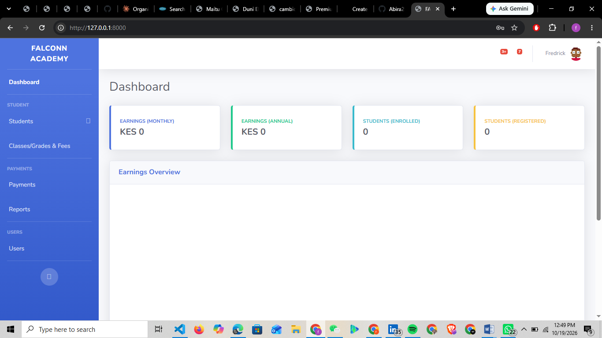
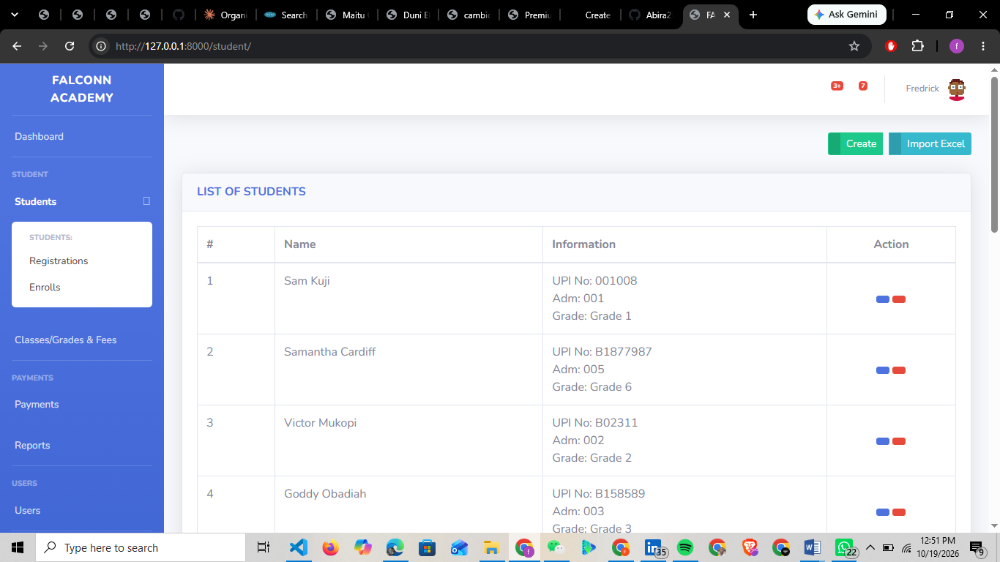
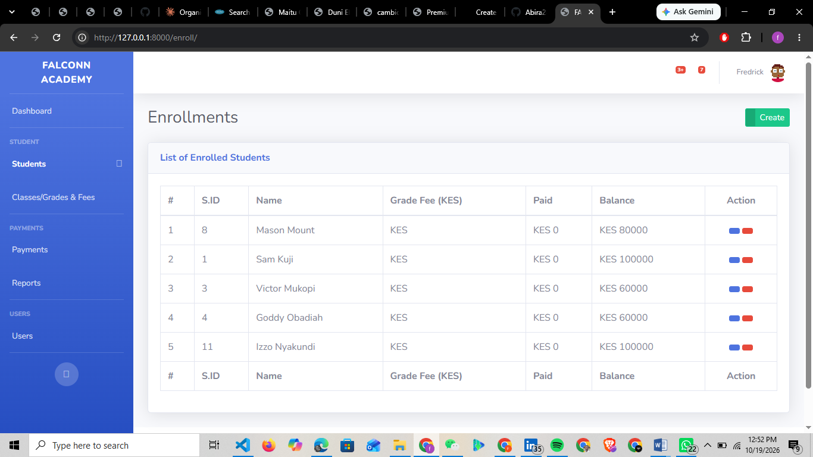
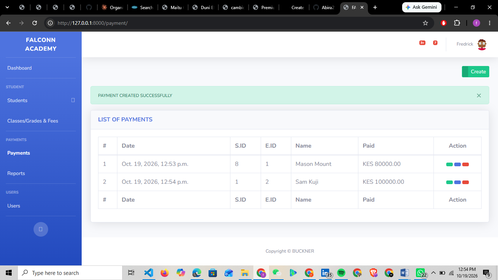

# Falconn Academy – School Management System

A Django-based web application designed to help manage student records, courses, enrollments, school fees, payments, and administrative activities for Falconn Academy.

## Overview

Falconn Academy is a school management system built with Python and Django. It provides a centralized platform for managing essential school operations and organizing student and financial records.

## Features

- **Student Management:** Add, view, update, and manage student records.
- **Course Management:** Manage classes or courses and their associated fees.
- **Enrollment Management:** Enroll students and maintain enrollment records.
- **Fee & Payment Management:** Track school fees, record payments, and monitor payment information.
- **User Authentication:** Support secure login and access to authorized system features.
- **Dashboard & Reports:** View key school information and relevant statistics.
- **Testing & Maintenance:** Identify and resolve application issues as development progresses.

## Technologies Used

- **Python** – Core programming language
- **Django** – Web application framework
- **HTML5** – Page structure
- **CSS3** – Styling
- **JavaScript / jQuery** – Interactive functionality
- **Bootstrap** – Responsive user interface
- **SQLite or PostgreSQL** – Database, depending on the configured environment

## Getting Started

Follow these instructions to set up the project locally.

### Prerequisites

Install the following:

- [Python](https://www.python.org/downloads/)
- [Git](https://git-scm.com/downloads/)

### Installation

**1. Clone the repository**

```bash
git clone https://github.com/Abira28/django-school-fee-management.git
```

**2. Navigate to the project directory**

```bash
cd django-school-fee-management
```

**3. Create a virtual environment**

```bash
python -m venv .venv
```

**4. Activate the virtual environment**

On Windows PowerShell:

```powershell
.\.venv\Scripts\Activate.ps1
```

**5. Install the required packages**

If the repository contains a `requirements.txt` file, run:

```bash
pip install -r requirements.txt
```

**6. Configure the database and environment**

Check the Django settings and configure the database and required environment variables for your local setup. Do not publish secret keys, passwords, or other sensitive configuration details.

**7. Apply database migrations**

```bash
python manage.py migrate
```

**8. Create an administrator account**

```bash
python manage.py createsuperuser
```

Follow the prompts to create your account.

**9. Start the development server**

```bash
python manage.py runserver
```

Open the local development address in your browser:

http://127.0.0.1:8000/

*Note: These instructions assume the project contains `manage.py` in its root directory. Adjust any step if your repository uses a different structure.*

## Screenshots

Screenshots of the application will be added here to demonstrate the dashboard and main system features.

Suggested screenshots:

- Dashboard
- Student Management
- Course Management
- Enrollment Management
- Fee & Payment Management

## Testing

Test the main application workflows, including student registration, course management, enrollment, fee calculations, payment records, and authentication.

Run the Django system checks with:

```bash
python manage.py check
```

## Deployment

Deployment to a production hosting platform is planned. Production setup should include appropriate environment variables, database configuration, static file handling, allowed hosts, and HTTPS.

## Project Roadmap

- [x] Student Management
- [x] Course Management
- [x] Enrollment Management
- [x] Fee & Payment Management
- [ ] User & Authentication Management
- [x] Dashboard & Reports
- [ ] Testing & Bug Fixes
- [ ] Deployment
- [ ] Add application screenshots

*Update the roadmap checkboxes to reflect the actual implementation and testing status before publishing.*

## Future Improvements

- Improve reporting and fee tracking.
- Add additional validation and automated tests.
- Enhance the user interface and accessibility.
- Deploy the application for online access.

## Author

**Abira28**

GitHub: https://github.com/Abira28

---

*Falconn Academy – School Management System is an ongoing project developed for school administration and fee management.*


## Screenshots

### Dashboard


### Student Management


### Enrollment Management


### Payment Management



## Technologies Used

- **Python** – Main programming language
- **Django** – Web application framework
- **HTML5** – Page structure
- **CSS3** – Styling
- **JavaScript** – Client-side interactions
- **Bootstrap** – Responsive interface styling
- **SQLite** – Local development database
- **Git and GitHub** – Version control and source code hosting


## Testing

Run Django's system checks:

```bash
python manage.py check
```

Run the automated tests:

```bash
python manage.py test
```

## Future Improvements

- Add search, filtering, and pagination for student records.
- Improve payment receipts and financial reports.
- Add role-based permissions for administrators and staff.
- Improve form validation and error handling.
- Deploy the application to a production hosting platform.

## Project Status

This project is under active development. Features and improvements may be added over time.

## Author

**Fredrick Abira**

GitHub: [@Abira28](https://github.com/Abira28)
